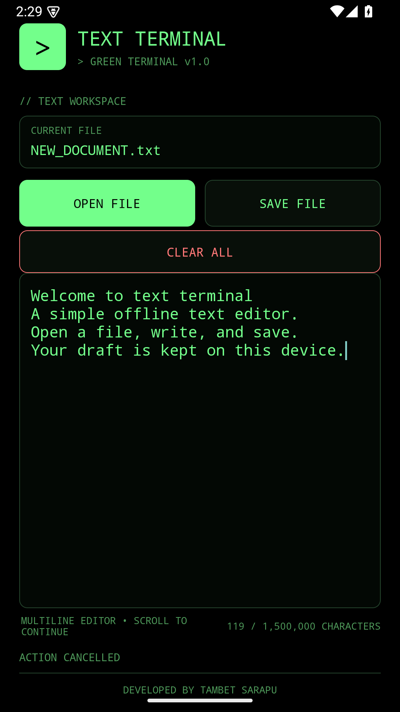

# Text Terminal

Text Terminal is a lightweight Android text editor with a green-on-black,
terminal-inspired interface. It lets you create, open, edit, and save plain
text documents using Android's built-in document picker.

## Features

- Create and edit multiline plain-text documents.
- Open and save files with Android's system file picker.
- Clear the editor after confirming; this does not change a saved file until
  you save again.
- Continue typing past the visible editor area; the editor scrolls and shows a
  live character count.
- Automatically save a private draft while editing and restore it next time.
- Handle documents up to 4 MB and 1,500,000 characters.
- Work offline: the app does not request internet access or contain networking
  code.

## How to use

1. Launch **Text Terminal** and tap the editor to start writing.
2. Tap **SAVE FILE** to choose a location and filename in Android's save
   dialog. Save again after making further changes.
3. Tap **OPEN FILE** to select a text document to edit.
4. Tap **CLEAR ALL** and confirm to empty the editor. Cancel in the confirmation
   dialog to keep the current text.
5. For longer documents, keep typing; the editor scrolls automatically. The
   character counter shows how much of the document limit is in use.

Unsaved work is kept as a private app draft and restored when the app is opened
again. Drafts are local to the device and are not exported with saved files.

## Privacy

Text Terminal has no internet permission, rejects cleartext network traffic,
and disables app-data backup and screenshots. Files are accessed only when you
choose them through Android's document picker. A cloud-backed location offered
by that picker may use its own network connection. Saved text files are
ordinary readable files, so use your device's storage and sharing controls to
protect them.

## Build and test

Open this folder in Android Studio and allow Gradle sync, or build with Gradle
and Android SDK installed:

    gradle assembleDebug

Run the unit tests and Android lint checks:

    gradle testDebugUnitTest lintDebug

The debug APK is written to app/build/outputs/apk/debug/app-debug.apk.
